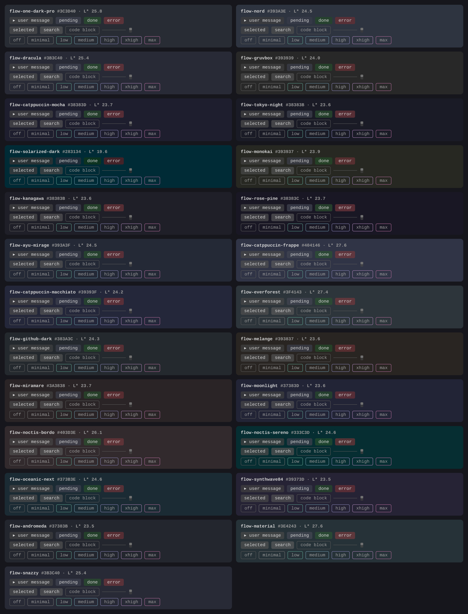

# Design principle: backgrounds carry state and theme hue, foregrounds carry identity

> 中文：[design.md](design.md) · Back to [README.en.md](../README.en.md)

Three metrics are used below; here is what they mean:

- **Contrast ratio `N:1`** — WCAG relative-luminance contrast: how much brighter or darker the
  foreground is than its background. 1:1 is the same color; 3:1 is the minimum legibility bar for UI
  elements and large text; 4.5:1 is the bar for body text; 7:1 and up counts as high contrast. This
  collection's criteria: body text ≥ 4.5, every other readable element ≥ 3.
- **CIE L\\*** — perceptual lightness, 0 = pure black, 100 = pure white, on a scale that is linear to
  the human eye. Two backgrounds need a ΔL\\* of about 5 before you can reliably tell "this is a
  panel".
- **ΔE** — the overall perceptual difference between two colors (lightness + hue + saturation). ~2 is
  just noticeable, above 10 is separable at a glance, and above 20 the colors are clearly different.

Every number in this document can be recomputed with `python3 build_themes.py --measure`; pass it a
few hex values and it prints pairwise contrast / ΔE / ΔL\\*.

pi has no global background token: the canvas is the terminal's own background color, and a theme
only controls what is drawn on top of it. Upstream palettes typically define a dozen-odd colors and
editor roles, while pi has 56 tokens, 19 of which are UI surfaces that don't exist in an editor: the
user message box, three tool status boxes, selection, search, dividers, scrollbar, and the seven
thinking-level borders.

## UI layer: shared lightness and state distances, theme-specific background hues

All 19 tokens start from one shared baseline. The eight actual backgrounds (user/custom messages,
three tool boxes, selection, search, and scrollbar track) receive **one common** theme color shift:
30% of the official canvas color's CIE Lab a\\*/b\\*. To avoid overly bright panels on dark
canvases, when the user panel is more than 8 L\\* above the official canvas, the whole background
group drops by at most 4 L\\* rather than forcing identical contrast across themes. Applying one
vector to the whole group preserves relative lightness levels and pairwise ΔE. After quantisation
to 8-bit sRGB, `--check` requires actual versus computed-target L\\* drift ≤ 0.25 and pairwise
state-box ΔE drift ≤ 1.5. The other 11 divider, scrollbar-thumb, and thinking-border colors remain shared.

Solarized restores **all 37 foreground tokens to official values** through explicit lightness targets: its
user/custom panels and scrollbar track use L\\* 19.5, its three tool boxes use 18, and selection /
search use 22.5 / 25.5. Official base1 then measures 4.97:1 on user panels and 4.55:1 on selection,
violet labels 3.04:1, tool titles 5.20:1, and red diff deletions 3.01:1. `--check` validates these
explicit L\\* targets and absolute state-box ΔE floors instead of the shared lightness baseline.
The tradeoff is a smaller panel-to-canvas ΔL\\* and weaker panel boundaries on brighter terminal
backgrounds; official-foreground legibility takes priority here.
Nord separately lowers the whole background group by 3 L\\* (user panels 24.5, tool boxes 24.2/25.3,
selection/search 27/30) without changing foreground mappings. Explicit-override themes are checked
against their target L\\* and absolute state-box ΔE floors.

| Element | Shared baseline (the first four rows vary by theme) | CIE L\\* |
|---|---|---|
| User message box, custom message box | `#414141` | 27.5 |
| Tool running | `#3E4049` (slightly cool gray; ΔE 6 from the user box — noticeable, not attention-grabbing) | 27.2 |
| Tool success / failure | `#2E4931` / `#61373A` | 28.3 (ΔE 20 / 20 from the user box, 36 between the two — separable at a glance) |
| Selection / search highlight | `#474747` / `#4E4E4E` | 30 / 33 |
| Dividers, code block border, thinking off | `#575757` | 37 |
| Scrollbar thumb, thinking minimal | `#727272` | 48 |
| thinking low → max | `#5EA190` `#6E96AA` `#8985B7` `#AB85B7` `#B66D9D` | teal → blue → blue-violet → purple → magenta |

The lightness targets come from measured default backgrounds of mainstream terminals (the defaults
in each terminal's source):

| Terminal / scheme | Background | L\\* |
|---|---|---|
| kitty, Windows Terminal Vintage / Ottosson | `#000000` | 0 |
| Windows Terminal Campbell | `#0C0C0C` | 3 |
| Alacritty default, VS Code Dark Modern terminal pane | `#181818` | 8 |
| GNOME dark, VS Code Dark+ | `#1E1E1E` | 11 |
| Konsole Breeze | `#232627` | 15 |
| Ghostty default, One Half Dark | `#282C34` | 18 |
| WezTerm default, GNOME Tango dark | `#333333` / `#2E3436` | 21 |
| The 25 schemes' own canvases in this set | Rosé Pine `#191724` … Catppuccin Frappé `#303446` | 8.5–22.0 |

Dark terminal backgrounds almost all fall in L\\* 0–22. The panel baseline is 27.5, with the small dark-canvas
adjustment above: on the brightest
canvas in the set (Catppuccin Frappé `#303446`, L\\* 22.0) they are still 5.5 L\\* brighter than the
background — just past the "you can tell it's a panel" line — and 27.5 brighter on pure black (the
same magnitude as pi's built-in dark on a black background). Terminals with backgrounds brighter
than L\\* 22 are outside the design envelope.
The image below shows every theme's actual UI backgrounds on its own official canvas (generated
with `--preview`):

The thinking-level border colors encode only the level: five levels, five colors, low-stimulation,
no alarm colors such as red or yellow, and identical across themes.

## Foreground layer: how bright a terminal background each theme supports

The foregrounds are official colors, but the canvas is the terminal's own background, so how bright
a background each theme stays readable on differs from theme to theme. `--check` recomputes every
canvas foreground against each background in the table above and reports the brightest background on
which everything still passes 3:1 / 4.5:1 (excluding colors already listed under known costs); on
brighter backgrounds, the first casualties are the theme's secondary foregrounds — dim / borders /
comments — while body text is unaffected.

| Brightest supported background | Themes |
|---|---|
| L\\* 21–22 (WezTerm `#333333`, GNOME Tango, their own canvases) | One Dark Pro, Nord, Tokyo Night, Catppuccin Frappé / Macchiato, Everforest, Miramare, Moonlight, Oceanic Next, Synthwave '84, Material |
| L\\* 18 (Ghostty `#282C34`, One Half Dark) | Gruvbox, Solarized, ayu Mirage, Melange, Noctis Bordo / Sereno, Snazzy, Dracula (own canvas 17.3) |
| L\\* 15–16 (Konsole Breeze `#232627`) | Catppuccin Mocha, Kanagawa, Monokai, GitHub Dark, Andromeda |
| L\\* 11 (GNOME dark, VS Code Dark+ `#1E1E1E`) | Rosé Pine (its pine keywords and muted gray fall below 3:1 on brighter backgrounds) |

## Foreground layer: official colors first

The remaining 37 tokens (body / secondary / status line, syntax, markdown, status colors, accent,
borders) in principle use only hex values from the official palettes, with roles mapped per the
original authors' highlight definitions; the sources are documented in the comment block above each
theme in `build_themes.py`. Solarized's background exception restores every foreground to an official
value, leaving only one custom foreground in the collection: Nord's tool output `#ACC0D5`, a nord9/nord6
mix (nord9 is 3.69:1, too close to the box; nord4/nord5/nord6 are the 7.4-8.6:1 body whites;
60% nord9 + 40% nord6 gives 5.32:1).

Known costs of sticking to official colors (`--check` lists these; left unfixed on purpose):

- Comments and the status line sit at 2.2–3.0:1 in One Dark / Nord / Tokyo Night / Solarized /
  Miramare / Oceanic Next / Material, below the 3:1 legibility line — the original authors made
  comments dark by design; that is what these schemes look like.
- Some official colors run dark against the deep tool-box backgrounds: the diff deletion colors of
  Nord / Monokai / Gruvbox / Andromeda / Noctis measure 2.1–3.0:1, and Kanagawa's oniViolet tags and
  autumnGreen measure 2.9:1 — all slightly below 3:1.
- Body text passes the 4.5:1 legibility line on every canvas, but One Dark and Solarized miss the 7:1
  high-contrast bar at 6.6:1 / 5.6:1. One Dark's body text reaches only 4.4:1 on the theme-tinted
  selection background — it is brighter than the canvas, and the official body color has no brighter step.
- Dracula's tool title uses official pink, 4.14:1 on the theme-tinted success box, slightly below the
  4.5:1 body-text line; the bold command text is still crisp.
- Text hierarchy: Dracula officially has just one gray (comment), so muted equals dim and the three
  text levels collapse to two; One Dark's and Solarized's body vs. secondary text differ by only about
  ΔL\\* 5 (official fg vs. statusFg and base1 vs. base0 are close to begin with).
- Synthwave '84's body text is the official `colors.foreground` pure white `#FFFFFF` (upstream has
  no editor.foreground), the brightest body text in the set.

Intentional role or value deviations (all still official colors of the theme — only the roles differ
from upstream; re-verified hex-by-hex against upstream on 2026-09-19):

- **Readability-driven**: Nord body text uses nord4 (the official Snow Storm "dark to bright" style,
  nordtheme/vim's Normal fg), with nord6 kept for elevated text (own messages, search hits, code
  blocks) and nord9 for secondary text (thinking/quotes), with tool output on the in-between mix
  `#ACC0D5` (60% nord9 + 40% nord6: nord9 reaches only 3.7:1 on the shared tool boxes and shares the
  pending box's blue-grey hue; the next official steps, nord4/nord5/nord6, are the 7.4-8.6:1 body
  whites, and nord5 sits dE 2.4 from nord6; the mix measures 5.3:1;
  diff context lines stay nord4 gray); Solarized body, user/custom message, and tool title text use base1,
  tool output and diff context use base0, labels use violet, and diff deletion uses red, all supported by
  the lower-L* backgrounds above rather than custom foregrounds; Kanagawa diff deletion
  uses waveRed (autumnRed is only 2.1:1 inside the box) and borders use ui.special's springViolet1
  (upstream's divider is a background color); One Dark's on-panel text uses its bright foreground
  `#D7DAE0`; Miramare's secondary text, blockquotes, and borders use orange (the official Grey
  `#444444` is unreadable on a terminal canvas and upstream has no secondary text level); Noctis's
  in-box secondary text uses official TEXT (comment is only 2.3:1 inside the box); Oceanic Next's
  secondary text uses `#A7ADBA` from the official extended palette; Material's borders and tool
  title use base04 (base03 is the comment color, too dark; base05 `#EEFFFF` is glaring as a title;
  base0D is 4.32:1 inside the box); Monokai's tool title uses official
  `editorLineNumber.activeForeground` `#C2C2BF` (fg `#F8F8F2` is glaring as a title, and the accent
  green would match the success box); Catppuccin Frappé / Macchiato link URLs use overlay1 (the
  overlay0 that Mocha uses is 2.9:1 on these two brighter canvases); Tokyo Night diff deletion uses
  red (upstream's diff foreground git.delete `#914C54` is too dark inside the box); Andromeda tags
  use blue (pink is 2.84:1 on panels).
- **pi has no matching role, so a nearby official role of the same theme is used**: all three
  Catppuccin themes use lavender for titles and mauve for list bullets (upstream blue / teal);
  Andromeda uses cyan for list bullets (upstream yellow); Synthwave '84 swaps link text / URL
  relative to upstream (green / yellow, so the URL gets the quieter of the two), and warning uses
  yellow (upstream's editorWarning is success-green); One Dark Pro uses cyan for operators (upstream
  has cyan only for logical / arithmetic operators; the generic keyword.operator is fg); Oceanic
  Next uses fg for punctuation (upstream teal); Melange / Miramare take diff foregrounds from the
  official b/c scales (upstream renders diffs as background blocks, while pi's diff is foreground
  text inside a shared box).
- **Upstream itself has version drift**: ayu Mirage follows mirage.yaml at the head of the
  ayu-colors repo (the npm-published ayu 8.0.1 still carries old values, e.g. the function color
  `#FFD173`); Solarized's green uses the canonical `#859900` (the vim file enables the
  "experimental" green `#719E07`); Andromeda's comments drop the upstream `cc` alpha.
