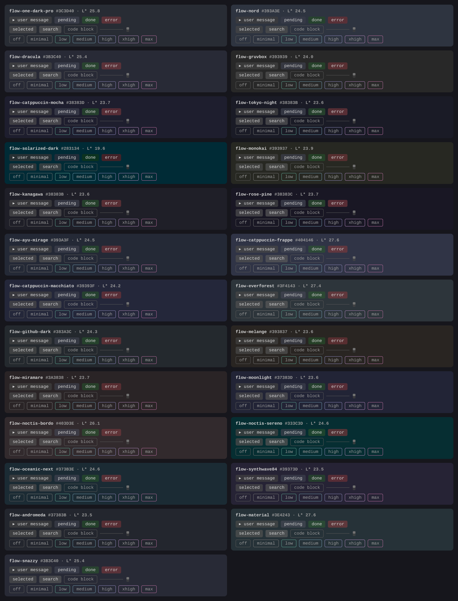

# 设计原则：背景承载状态与主题色相，前景承载个性

> English: [design.en.md](design.en.md) · 返回 [README](../README.md)

下文用三种度量，含义如下：

- **对比度 `N:1`**：WCAG 相对亮度对比，前景相对背景的明暗比。1:1 是同色；3:1 是 UI 元素和大字的最低可读线；
  4.5:1 是正文的可读线；7:1 起算高对比。本集的判据：正文 ≥ 4.5，其余可读元素 ≥ 3。
- **CIE L\***：感知亮度，0 = 纯黑，100 = 纯白，刻度按人眼线性。两块底色的 ΔL\* 差 5 左右才能稳定分辨出"这是一块面板"。
- **ΔE**：两种颜色在感知上的总差异（亮度 + 色相 + 饱和）。约 2 是刚能察觉，10 以上一眼可分，20 以上是明显不同的颜色。

本文所有数字都能用 `python3 build_themes.py --measure` 重新算出；给它几个 hex 则输出两两之间的对比度 / ΔE / ΔL\*。

pi 没有全局背景 token，画布就是终端自己的背景色，主题只能决定画在其上的东西。
上游调色板一般只定义十几个颜色和编辑器角色，而 pi 有 56 个 token，其中 19 个是编辑器里不存在的
UI 面：用户消息盒、三种工具状态盒、选中、搜索、分隔线、滚动条、thinking 七档边框。

## UI 层：共享亮度与状态距离，背景色随主题

这 19 个 token 以同一组常量为基准。其中 8 个真正的背景 token（用户/自定义消息盒、三种工具盒、选中、搜索、
滚动轨道）在各自基准色上叠加**同一个**主题色偏移：取官方画布色的 CIE Lab a\*/b\* 各 30%。为避免
深画布上的面板过亮，当用户面板比官方画布亮超过 8 个 L\* 时，整组背景最多下调 4 个 L\*，不追求
各主题对比度完全一致。整组使用同一向量而非逐盒独立调色，保留相对亮度层级与背景间 ΔE；转回 8 位
sRGB 后，`--check` 要求实际色与计算目标 L\* 的误差 ≤ 0.25、状态盒两两 ΔE 漂移 ≤ 1.5。
其余 11 个分隔线、滚动块和 thinking 边框色仍全主题共享。

Solarized 为让 **37/37 前景 token 全部使用官方色值**，用户/自定义面板与滚动轨道改用
L\* 19.5，三个工具盒用 18，选中/搜索用 22.5/25.5。文字层级整体提高一档：base2 正文/标题、
base1 次要文字/工具输出、base0 状态行/注释/URL。此时正文在用户面板为 10.85:1、选中底为
9.93:1，violet 标签为 3.04:1，工具标题为 11.35:1，工具输出为 5.20:1，红色 diff 为 3.01:1。
`--check` 校验这些显式目标 L\* 及状态盒的绝对 ΔE 下限，不再要求该主题保持共享亮度。
代价是面板与画布的 ΔL\* 缩小，在较亮终端底色上面板边界较弱；这里优先保证官方前景的可读性。
Nord 另将整组背景下调 3 个 L\*（用户面板 24.5、工具盒 24.2/25.3、选中/搜索 27/30），
保持背景间的相对层级。显式覆盖主题均校验目标 L\* 与状态盒的绝对 ΔE 下限。

| 元素 | 共享基准色（前 4 行实际色随主题） | CIE L\* |
|---|---|---|
| 用户消息盒、自定义消息盒 | `#414141` | 27.5 |
| 工具执行中 | `#3E4049`（微冷灰，与用户盒 ΔE 6：能察觉、不抢眼） | 27.2 |
| 工具成功 / 失败 | `#2E4931` / `#61373A` | 28.3（与用户盒 ΔE 20 / 20，两者之间 36：一眼可分） |
| 选中 / 搜索高亮 | `#474747` / `#4E4E4E` | 30 / 33 |
| 分隔线、代码块边框、thinking off | `#575757` | 37 |
| 滚动块、thinking minimal | `#727272` | 48 |
| thinking low → max | `#5EA190` `#6E96AA` `#8985B7` `#AB85B7` `#B66D9D` | 青→蓝→蓝紫→紫→洋红 |

亮度取值来自主流终端**默认底色**的实测（各终端源码里的默认值）：

| 终端 / 方案 | 底色 | L\* |
|---|---|---|
| kitty、Windows Terminal Vintage / Ottosson | `#000000` | 0 |
| Windows Terminal Campbell | `#0C0C0C` | 3 |
| Alacritty 默认、VS Code Dark Modern 终端面板 | `#181818` | 8 |
| GNOME dark、VS Code Dark+ | `#1E1E1E` | 11 |
| Konsole Breeze | `#232627` | 15 |
| Ghostty 默认、One Half Dark | `#282C34` | 18 |
| WezTerm 默认、GNOME Tango dark | `#333333` / `#2E3436` | 21 |
| 本集 25 套配色自身的画布 | Rosé Pine `#191724` … Catppuccin Frappé `#303446` | 8.5–22.0 |

暗色终端底色几乎都落在 L\* 0–22。面板基准为 27.5，深画布主题再按上述规则小幅下调；在本集最亮的画布（Catppuccin Frappé `#303446`，L\* 22.0）上仍比底色亮
5.5 个 L\*（刚好过"能分辨出面板"的线），在纯黑上亮 27.5（与 pi 内置 dark 在黑底上的量级相当）。底色比 L\* 22 更亮的终端
不在设计范围内。
下图展示每套主题的实际 UI 背景画在各自官方画布上的效果（`--preview` 生成）：

thinking 等级的边框颜色只表示等级，五档五色、低刺激、不用红黄这类警报色，也不随主题变化。

## 前景层对终端底色的支持范围

前景是官方色，画布却是终端自己的底色，所以每套主题能在多亮的底色上保持可读各不相同。
`--check` 对上表每种底色重算全部画布前景，报告"最亮还能全过 3:1 / 4.5:1 的底色"；
底色比这更亮时，最先失守的是该主题的 dim / 边框 / 注释一类次要前景，正文不受影响。

| 可用到的最亮底色 | 主题 |
|---|---|
| L\* 21–22（WezTerm `#333333`、GNOME Tango、各自画布） | One Dark Pro、Nord、Tokyo Night、Catppuccin Frappé / Macchiato、Everforest、Miramare、Moonlight、Oceanic Next、Synthwave '84、Material |
| L\* 18（Ghostty `#282C34`、One Half Dark） | Gruvbox、Solarized、ayu Mirage、Melange、Noctis Bordo / Sereno、Snazzy、Dracula（自身画布 17.3） |
| L\* 15–16（Konsole Breeze `#232627`） | Catppuccin Mocha、Kanagawa、Monokai、GitHub Dark、Andromeda |
| L\* 11（GNOME dark、VS Code Dark+ `#1E1E1E`） | Rosé Pine（pine 关键字与 muted 灰在更亮的底上跌破 3:1） |

## 前景层：以官方色为主

其余 37 个 token（正文 / 次要 / 状态行、语法、markdown、状态色、accent、边框）优先取官方调色板的色值，
角色按原作者的高亮定义映射，来源见 `build_themes.py` 每套主题头部的注释。官方色阶没有合适亮档时，
使用同主题两档官方色的 sRGB 混色：Nord 工具输出与可读红、Dracula 次要文字/注释、Miramare 状态行/注释、
Oceanic Next 与 Material 的状态行/注释。混色不引入其他主题的色相。

## 可读性修正与剩余取舍

早期版本把低对比项列入 `KNOWN` 白名单；实际使用反馈后，这些例外已全部修正并删除。
现在 `--check` 对 25 套主题的每个受检可读前景/背景组合严格执行正文 ≥ 4.5:1、其余可读元素 ≥ 3:1。

- 检查覆盖：Markdown 与语法 token 目前只在画布上测量，它们在消息面板和工具盒内的组合尚未全量纳入；
  因此“过线”只指报告中列出的组合，不代表所有实际渲染组合。本次调整的 One Dark / Tokyo Night 注释与 URL
  已另行验证在消息面板和工具盒内也超过 3:1，其他主题的完整面板覆盖仍是后续工作。
- One Dark 正文在画布上为 6.6:1，没到 7:1 的高对比；在主题化选中底上为 4.64:1，仍过正文线。
- 非正文的门槛是 3:1，不代表所有文字都达到 4.5:1：Solarized 的部分官方状态色、Monokai 的引用与
  工具输出等仍在 3–4.5:1 区间，以保留原配色的层次。
- 文字层次：Dracula 官方只有 comment 一个灰，即使提高亮度后 muted 与 dim 仍同色，三级文字只有两级；
  One Dark 的正文与次要文字只差 ΔL\* 5 左右（官方 fg 与 statusFg 本就相近）。
- Synthwave '84 的正文是官方 `colors.foreground` 纯白 `#FFFFFF`（上游没有 editor.foreground），是全集最亮的正文之一。

有意的角色或色值偏离（使用官方色，或同主题两档官方色的可追溯混色；2026-09-19 逐 hex 对照上游复核）：

- **可读性驱动**：One Dark 面板内文字用亮前景 `#D7DAE0`，注释用 statusFg（画布 5.65:1，
  消息面板/工具盒内最低 4.26:1；wordBorder 在消息面板上只有 2.89:1）；
  Nord 正文用 nord4，用户消息/搜索命中/代码块用 nord6，次要文字用 nord8，状态行/注释/URL 用 nord9，
  工具输出用 `#ACC0D5`（60% nord9 + 40% nord6，盒内 5.92:1），错误与 diff 删除用 `#C87D86`
  （80% nord11 + 20% nord6，画布/盒内最低 4.00/3.54:1）；Dracula 的 muted/dim/comment 用
  `#8894B8`（75% comment + 25% fg，4.73:1），工具标题用 fg；Tokyo Night 注释/URL 用 fg_dark
  （画布 8.10:1，消息面板/工具盒内最低 5.38:1；dark5 在消息面板上只有 2.80:1），
  diff 删除用 red；Solarized 使用上述 base2/base1/base0 文字色阶；Monokai 工具标题用
  `editorLineNumber.activeForeground` `#C2C2BF`，diff 删除用 invalid 红（盒内最低 3.13:1）；
  Kanagawa diff 删除用 waveRed，边框用 ui.special 的 springViolet1；Miramare 次要文字/引用/边框用 orange，
  状态行/注释用 `#938C7B`（60% lightGrey + 40% fg，4.55:1）；Noctis 盒内次要文字用官方 TEXT；
  Oceanic Next 次要文字用 `#A7ADBA`，状态行/注释/URL 用 `#86909C`（comment 与 base04 等比混色，4.50:1）；
  Material 边框与工具标题用 base04，状态行/注释用 `#839DA8`（base03/base04 等比混色，4.61:1）；
  Catppuccin Frappé / Macchiato 的链接 URL 用 overlay1；Andromeda 标签用 blue（pink 在面板上过暗）。
- **pi 没有对应角色，取同主题的相近官方角色**：Catppuccin 三套标题用 lavender、列表符用 mauve（上游 blue / teal）；
  Andromeda 列表符用 cyan（上游 yellow）；Synthwave '84 链接文字 / URL 与上游对调（green / yellow，让 URL 是较安静的
  一色），warning 用 yellow（上游 editorWarning 就是 success 的绿）；One Dark Pro 运算符用 cyan（上游只有逻辑 /
  算术运算符是 cyan，泛用 keyword.operator 是 fg）；Oceanic Next 标点用 fg（上游 teal）；Melange / Miramare 的 diff
  前景取自官方 b/c 色阶（上游的 diff 是背景色块，pi 的 diff 是共享盒内的前景文字）。
- **上游本身有版本差**：ayu Mirage 跟随 `ayu-colors` 仓库 HEAD 的 `mirage.yaml`（npm 发布的 ayu 8.0.1 仍是旧值，
  如函数色 `#FFD173`）；Solarized 的 green 取规范值 `#859900`（vim 文件里启用的是"实验"绿 `#719E07`）；Andromeda
  注释去掉了上游的 `cc` 透明度。
